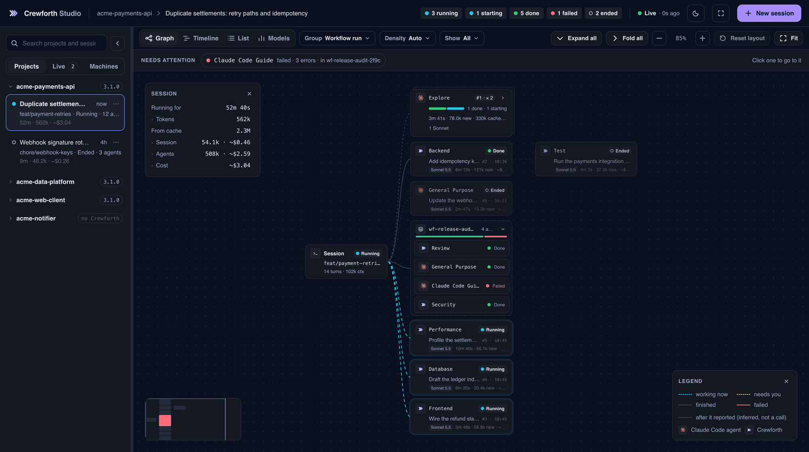
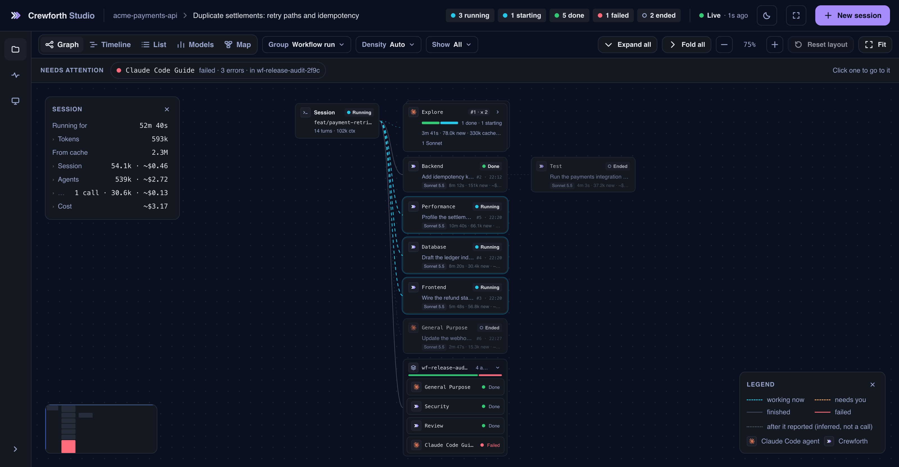
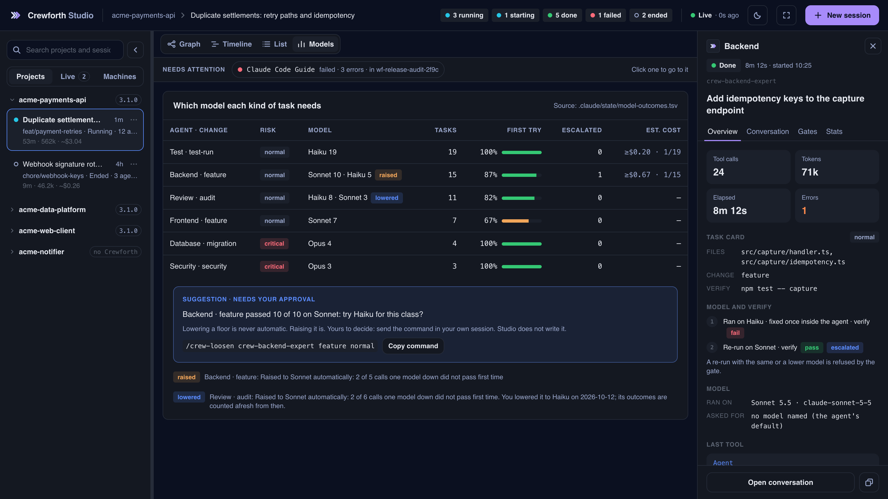

# Studio

A delegation three levels deep is, in a terminal, a scrollback you have already lost. **Crewforth Studio** is a local panel that draws it instead: one card per agent, appearing as they spawn, each carrying its status, the task it was given and the model it ran on. Selecting a card opens what the agent last reached for, what it has spent and what it reported back. The same session can be read as a graph of who started whom, as a timeline against the clock, and as a list sorted by what needs someone; a fourth view, **Models**, reads the project instead of the session: which model each kind of task has needed.

It reads `~/.claude/projects` — where Claude Code keeps every session on this machine — so one running panel sees all of them at once, whether or not a project has Crewforth installed, and without being started inside any of them.

```bash
/crew-studio                                       # in any project that has Crewforth
node .claude/studio/server/index.js --open        # the same, without the command menu
npx crewforth studio                              # without installing anything
# `node` not on PATH? Crewforth keeps its promise not to edit it — ask for the one it fetched:
#   NODE="$(bash .claude/studio/ensure-node.sh)" && "$NODE" .claude/studio/server/index.js --open
```

| In the panel | What it rests on |
|:--|:--|
| The delegation of any session, live, as a **Graph**, a **Timeline** or a **List** (`g`, `t`, `l`) | the transcript tree on disk, re-read on a size signature every 700 ms; the three views are drawn from that one reading |
| **Models** (`m`): which model each kind of task has needed in this project | `.claude/state/model-outcomes.tsv`, the record Crewforth's hooks write when a crew agent stops. Studio reads it and writes nothing |
| **Map** (`p`): the project's modules, what they connect to and what was found between them | `.crewforth/crew-map.json`, written by Crewforth's scanner. Studio reads it and scans nothing |
| Sessions the panel starts, driven from the conversation panel | `claude -p` in stream-json, over the child's stdin and stdout |
| A tool call in one of those parked in the approval dock until you answer; a question and a plan answered there too | a `PreToolUse` hook injected through the panel's own settings file. It answers a tool call at 45 s against the harness's 90 s, a question or a plan at 300 s, and **silence is a denial** — a panel that is closed does not become permission |
| Continuing a session rather than copying it | a bare `--resume` when no process holds that session, which keeps its id and appends to its transcript; a fork when one does, because two writers on one transcript corrupt it |
| What a session spent: time, tokens and an estimated cost | the usage each response carries in the transcript, priced at API list price. It is an estimate and is always written as one (`~$3.22`); on a subscription it is not what you are billed |
| The gate log, session stats and board | Crewforth's existing scripts, read rather than recomputed — and gate-log entries are labelled as carrying no timestamp, because that format has none |

<div align="center">
  
  <br><sub>The same panel, driven: the graph and an agent's inspector, the Timeline, the List, the Models view, a request answered in the dock, the New session panel.</sub>
</div>

## Three views of one session

- **Graph**: the delegation in its own shape. The session is on the left, the agents it started are to its right, and a workflow run is one group that folds. A strip above the canvas names what needs attention, and a click goes to it.
- **Timeline**: the same agents against the clock, one row each, and a drawer with the selected agent's last error. The time an agent spent waiting for you is drawn only for a session Studio started, and only since the panel started, because that record is kept in memory. For any other session the Timeline says `Not measured: this session's approvals are not seen by Studio` instead of drawing a session in which nobody waited.
- **List**: the agents sorted by what needs someone. Requests waiting for you come first, then failed and running; done and ended are folded.

Selecting an agent in any view opens the inspector, with four tabs: **Overview** (tool calls, tokens, elapsed time, errors, its task card and how its work went, the model it ran on, the last tool, the skills it applied, who delegated it, and its report), **Conversation**, **Gates** and **Stats**. The **Report** is what the agent handed back to whoever started it, read from the hand-back record in the transcript; an agent that has not handed anything back says so.

## Reading the graph

**Grouping.** The Group menu draws the same agents five ways: by **Workflow run**, by **Agent type**, by **Parent**, in **Order**, or with **None**. Agents of one type under one parent stand as one card (`Frontend ×4`) that opens beside itself; **Expand all** and **Fold all**, in the toolbar, open and fold every group at once, groups inside groups included, and work on the Timeline and the List too.

**Order.** Every agent carries the number it was started with (`#3`). The **Order** grouping lays the session out in waves, one column per wave of agents started together. A dotted line from an agent to a later wave says that wave was called *after that agent reported*. It is inferred from the order of events and is drawn differently from a call for that reason: the session calls every agent, and no agent called the next.

**Density.** At **Auto**, cards stay cards while the picture fits the pane at a readable zoom (75%), and become one-line chips when it does not; the button then reads **Auto · compact** and its tooltip says why. A taller window gets its cards back. While a window's edge is being dragged the picture follows it, and Auto chooses between cards and chips once the window has stopped, so the cards do not flicker as the edge passes the limit. A chip still says its model in full, and a compact group card keeps the models its agents ran on (`3 Sonnet · 2 Opus`). **Comfortable** and **Compact** fix the choice.

**Layout.** A card can be dragged, and stays where it is put. **Reset layout** (`r`) puts every moved card back where the layout would have it, and the notice that follows offers **Undo**.

**Whose agent it is.** A card's mark says it: Crewforth's three chevrons for an agent that Crewforth installed, and the Claude mark for every other agent. The tooltip of the second kind reads **Claude Code agent** and, under it, where the agent is defined: `Defined in this project: .claude/agents/<file>`, `Defined in your own agents: ~/.claude/agents/<file>`, `Defined in the plugin "<name>"`, or `No definition file found`, which is what a built-in type gets. Studio keeps no list of Claude Code's built-in agents; a type added tomorrow is drawn like the ones there today.

**The model.** Each card carries the model its agent ran on (`Sonnet 5.5`), read from the agent's own transcript. The inspector's **Model** section has both sides: **Ran on**, and **Asked for**, the model its call named, or that it named none and took the agent's default. An agent that repeats a task one model up says the step on its card (`Sonnet → Opus`). The Show menu can keep only the agents of one model lit.

**What the session spent.** The session's card opens a short table: how long it has run, **Tokens** (new ones: input, output and cache writes), **From cache** (the same context read back, counted apart because it would otherwise be nearly all of the number), and **Cost** for the session and for its agents. Cost is each response's usage at API list price. A session that consulted Claude Code's advisor also shows **Advisor**: how many calls, their tokens and their cost, priced at the advisor model's own rates. The API leaves those tokens out of a response's top-level usage, so they are read from its `iterations` and added to the totals; a session with no call has no such line. A model the price table has no row for has no price: the row then says `No estimate` and names the model, rather than counting it as zero.

<div align="center">
  
  <br><sub>Who is running, who finished and who failed, and on which model. The failed agent is named in the strip above the canvas, one click away.</sub>
</div>

## Models: which model each kind of task needs

Crewforth's model routing gives every crew agent's task a card (the files it may touch, the kind of change, the command that proves it) and records how the work went when the agent stops. The **Models** view (`m`) is that record, read for the project the session on screen belongs to. One line per class: an agent, a kind of change and a risk.

| Column | What it says |
|:--|:--|
| **Agent · change**, **Risk** | the class. The risk is `critical` or `normal`, as the hook classified the task |
| **Model** | what the class ran on, with a count for each model. A class Crewforth holds one model up carries **raised**; one you lowered again carries **lowered** |
| **Tasks** | how many tasks of the class are on record |
| **First try** | the share of *verified* tasks whose verify command passed with no fix by the agent. A task whose command was not there, was not allowed to run or ran out of time got no verdict and is in no rate; a class with no verified task shows a dash, not a zero |
| **Escalated** | how many tasks repeated a card that had failed one model down |
| **Est. cost** | what the class's agents come to at API list price. Where only some of its tasks could be priced, the cell is a floor and says so: `≥$0.75 · 2/7` is the sum of two tasks out of seven. An **advisor** tag marks a class whose agents consulted Claude Code's advisor; hovering it gives the number of calls and how much of the cost they were, already included |

**Raised and lowered.** When the first try of a class fails too often on one model, Crewforth holds the class one model up. That is automatic, and the line under the table says what raised it. Lowering is never automatic. When a held class has since passed its last ten verified tasks first time, the view offers the lowering as a **Suggestion** with one button, **Copy command**. It copies `/crew-loosen <agent> <change> <risk>` and does nothing else: the floor is lowered when you send that command in your own session, one model down, once for each raise. **Studio writes nothing here.** A request from the panel can be sent by any process running as you, so a button in it cannot stand for you; the command is recorded only from a message you typed.

**Above the table.** The gate holds a floor, not a ceiling: normal work may run on a model above the one the table asks for it. Under the table, **Above the table · nothing is blocked** lists the classes of normal work that ran higher than both Sonnet and the floor the gate held them to (an agent's own floor, a raise, a re-run one model up and the project's `floor` rules are not counted), with what each cost as run and the same tokens at Sonnet's list price, which another model would not have spent exactly. That Sonnet is enough for a class is said only when its last ten verified tasks on Sonnet all passed first time; until then the line says it is not measured. Nothing in the box is acted on.

**The task card in the inspector.** An agent that was given a card shows it in its Overview: `files`, `change` and `verify` as they were written, with the risk beside the title. Critical work also shows **why critical**, in the gate's own words (`src/payments/p.ts is on a critical path: payments`, or `change: migration`); a line recorded before Crewforth kept that reason shows none rather than a guessed one. Under it, **Model and verify** tells the work as steps: what each call of that card ran on, what its verify command said (`pass` or `fail` as a tag; anything else in words, because it is no verdict), a fix made inside the agent, and the re-run one model up, marked **escalated**.

What the view does not show: the record holds crew agents only. Model routing applies to agents whose type begins `crew-`; `Explore`, `general-purpose` and a project's own agents run on the model their call asked for, or else the main session's, and leave no line here. Their inspector says so under **Model routing**, so the missing card is not read as a lost record. A line of the record that Crewforth's hooks could not have written is not counted, and the header says how many were not read.

<div align="center">
  
  <br><sub>One line per kind of task. The suggestion copies a command; lowering a floor stays yours.</sub>
</div>

## Map: the project as its crew map shows it

The **Map** view (`p`, or **Map** under a project in the navigator, beside the number of findings it shows) draws `.crewforth/crew-map.json`, the map Crewforth's scanner writes (`bash .claude/eval/lib/crew-map/crew-map.sh`): the project's modules, the external resources they touch, the endpoints they provide and call, and the findings between them, each citing `file:line`. Studio only reads it. With no map, the view says how to write one; nothing is scanned from the panel.

Nodes sit in bands, from the top: **Clients**, **Entry points**, **Core**, **Infrastructure**, **External**. A band is what the map shows of a module: one that provides an endpoint or that a container builds is an entry point, one that only calls endpoints is a client, one another module references is core. A module the map does not place goes to **Unplaced** rather than to a guess. Lines are solid where a file proves them, dotted where they are inferred, and dashed with a **model** mark where the model proposed them; an external resource reached only by inferred lines has a dashed frame. Selecting a module lights its own lines and leaves the rest faint, and `Esc` lets it go. The pane pans and zooms like the graph's, with the same zoom, **Fit** and **Reset layout** controls: a card dragged stays where it was put for that project, and modules that share a folder in one band can be folded into one card and opened again.

| Part | What it does |
|:--|:--|
| **Source strip** | the file, the commit it was scanned at, and how many commits `HEAD` has moved since |
| **Layers** | Modules, External, Endpoints (each module's endpoints as chips), Findings |
| **Findings** | every finding, proven ones first. A rule the scanner marks as too often wrong is hidden by default and counted; **Show N hidden by default** brings it back. A row selects its module and brings its card to the middle of the pane |
| **Inspector** | Overview (what it connects to, and the node's own evidence), Connections (grouped by kind, in and out) and Findings, each with **Copy as task**, which copies the finding as text to paste into a session. Every `file:line` copies its path. **Not measured** is always at the bottom |
| **Legend** | what each line and frame means; a press anywhere outside closes it |
| **Compare with** | another project on this machine that has a map. Its calls that no endpoint of its own provides are matched against this project: its calling modules join **Clients**, each line says how many calls land here and how many are **missing**, and the missing ones join the findings |

On a phone the pane gives way to the findings and a list of the modules; a row opens the module in the inspector.

## The approval dock

A tool call in a session Studio started waits in a dock along the bottom of the panel, whichever session and view are on screen. It shows the agent that asked, the tool and its input, and three answers: **Allow once**, **Allow _tool_ this session** and **Deny** (`a`, `s`, `d`). Unanswered, the call is denied at 45 s. A session allowance is listed in the inspector's Gates tab and can be revoked there.

**A question and a plan are answered in the dock too.** When the session asks you something, the dock shows the question as a form: one choice or several, as it was asked, and **Send answers**. When it has a plan and asks to leave plan mode, the dock shows the plan with three answers: **Keep planning**, **Approve · accept edits** and **Approve · ask each time**. Both wait 300 s, because a question and a plan take longer to read than a command, and both are refused when nobody answers.

Allow is an answer to Claude Code. It does not go around anything:

- In the Accept edits and Default modes, Allow hands Claude Code an explicit allow. In Plan it says nothing, and Claude Code's own plan rules decide.
- A Crewforth gate or a `deny` rule in the project's settings still refuses a call you allowed (measured on Windows, in a real session). The conversation then carries a line saying the call was allowed here and who refused it. A click in Studio never stands in for an approval Crewforth asks you to type: `/crew-approve` is still yours to send.
- Studio's hook runs beside the project's other hooks, not after them, so the dock can ask about a call that another gate refuses anyway. That is a known limit.
- Two calls are not put to you, because there is nothing in them to judge: a lookup of a tool's definition, and, in plan mode only, the write of Claude Code's own plan file in its plans directory. The dock stays silent for them, which is not an approval: Claude Code decides them as it would with no panel. The plan itself still comes to the dock.

## Starting a session

**New session** opens a panel on the right: the project the session runs in, its permission mode, and an optional first message. Three modes are offered. **Plan** is the default: it reads and plans, and cannot change files. **Accept edits** and **Default** edit files and run commands, each call after you allow it in the dock. Modes that skip Crewforth's gates are not offered. If Studio is closed while such a session runs, its requests are denied.

**The mode is in the strip above the conversation, and it is a control.** `mode: plan` opens a menu of the same three, with the current one marked. The label changes when Claude Code itself reports the new mode, not when you click; a mode that skips the gates is refused by the server, whoever asks.

## A narrow window

Below 640 px the panel is one column. The navigator becomes a drawer, the inspector and the conversation each take the whole stage and stop above the dock, and the panel opens on the List, where a request's three answers sit one under the other. The Graph and the Timeline still open, and say `Best on a wider screen`. This is the layout a phone-sized window gets. It was checked in a narrow desktop browser window and is not measured on a phone, and the panel still listens on `127.0.0.1` only.

## Watching from another device

The panel's link carries the token that starts sessions and answers tool calls, so it is not a link to hand to a phone. A **viewer** is a second token that reads and changes nothing. In the navigator's **Machines** tab, under **Remote viewers**, **Add viewer** makes one and shows its link once, with **Copy link** beside it.

| | |
|:--|:--|
| What a viewer can do | every `GET` the panel makes: the sessions, the three views, Models, the conversations, the requests waiting in the dock |
| What it cannot | anything else. Starting a session, answering a request, changing a mode and sending a message are refused by the server with `403`, before the request is looked at. So is reading the list of viewers |
| What you see | each viewer's name, when it last asked and how many requests it has made, and `watching now` while it holds a live stream open |
| **Revoke** | the token stops working from the next request, and a stream the viewer holds open is closed |
| How long it lasts | as long as the server that made it. Viewers are kept in memory, like the panel's own token; a restart ends all of them. Eight at most |

**The server still listens on `127.0.0.1` only, and a viewer does not change that.** The way in from another device is a tunnel you run yourself; Studio starts none and opens no port. Two that keep the server on loopback:

```bash
# ssh: forward the port from the other device, then open the link as it was copied
ssh -N -L 7777:127.0.0.1:7777 you@this-machine

# Tailscale: serve the port inside your tailnet, then open the link with this machine's tailnet name
tailscale serve 7777
#   https://<this-machine>.<your-tailnet>.ts.net/?token=<the viewer's token>
```

The copied link names `127.0.0.1`. Through an ssh forward on the same port it works as it is; through a tailnet, keep the `?token=…` part and replace what comes before it with the address your tunnel gives. A viewer's page says **Read-only** in the top bar and has no **New session** button. The other controls are still drawn, and pressing one gets the server's refusal.

What was checked and what was not: the refusals are asserted against a running server in the panel's own test suite, and a viewer link was opened in a browser on the same machine, where revoking it closed its stream. It was not measured from a phone, nor through ssh or Tailscale.

**Studio installs with Crewforth.** `start.sh` and `adopt.sh` create six directories under `.claude/` and Studio is the sixth, so in any project that has Crewforth you open it with **`/crew-studio`** — or, without the command menu, `node .claude/studio/server/index.js --open`. It has zero npm dependencies, wants Node 18+, binds to `127.0.0.1` only and requires a per-run token on every API path. **No Node on the machine? Crewforth goes and gets one.** `.claude/studio/ensure-node.sh --plan` shows exactly what it would fetch — the current LTS from nodejs.org, checked against the published SHA-256 and unpacked into `~/.claude/studio-runtime` — and installs nothing until you say yes. No admin rights, no package manager, no PATH edit; deleting that one directory undoes it.

| Channel | Studio |
|:--|:--|
| `npx crewforth` · release tarball · git clone | installed to `.claude/studio/` |
| Claude Code plugin | shipped inside the plugin, opened with `/crewforth:crew-studio` (plugin commands are namespaced) |

All three channels carry it. One command file serves both editions: Claude Code substitutes the plugin's own install path into it, so the panel is found wherever it actually is. The panel behaves identically in both, with one honest gap — its telemetry reads the project you opened it from, and a plugin install puts no Crewforth files into a project, so the Gates and Stats tabs and the board report "not measured" with the reason rather than a misleading zero. The Gates tab still lists the gate decisions the plugin's guards logged to that project's `.claude/gate-log.tsv`.

It reads `~/.claude/projects`, which holds **every** Claude Code session on the machine. Starting it from a project root only decides which project it opens on.
