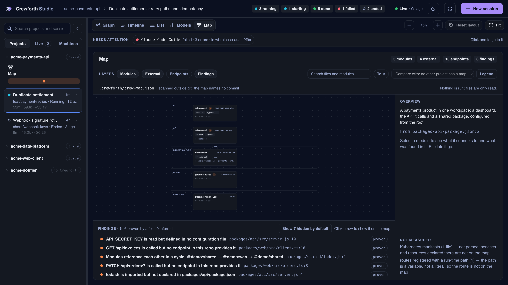

# Studio

Üç kademe derine inen bir delegasyon, terminalde çoktan kaybettiğiniz bir kaydırma geçmişidir. **Crewforth Studio** onu çizen yerel bir panel: her ajana bir kart düşüyor; kart, ajan doğduğu anda beliriyor ve ajanın durumunu, aldığı görevi ve koştuğu modeli taşıyor. Karta tıklayınca ajanın en son hangi aracı kullandığı, ne harcadığı ve geri ne bildirdiği açılıyor. Aynı oturum üç biçimde okunuyor: kimin kimi başlattığını gösteren bir grafik, saate karşı bir zaman çizelgesi ve kime ihtiyaç olduğuna göre sıralı bir liste. Dördüncü görünüm, **Models**, oturumu değil projeyi okuyor: her iş türüne hangi model gerekmiş.

Panel `~/.claude/projects` dizinini okuyor; Claude Code bu makinedeki bütün oturumları orada tutuyor. Dolayısıyla çalışan tek bir panel hepsini birden görüyor: projede Crewforth kurulu olsun ya da olmasın, panelin o projenin içinde başlatılmış olması da gerekmiyor.

```bash
/crew-studio                                       # Crewforth kurulu her projede
node .claude/studio/server/index.js --open        # aynısı, komut menüsü olmadan
npx crewforth studio                              # hiçbir şey kurmadan
# `node` PATH'te yok mu? Crewforth PATH'e dokunmama sözünü tutuyor — indirdiğini ondan isteyin:
#   NODE="$(bash .claude/studio/ensure-node.sh)" && "$NODE" .claude/studio/server/index.js --open
```

| Panelde ne var | Neye dayanıyor |
|:--|:--|
| Herhangi bir oturumun delegasyonu, canlı; **Graph**, **Timeline** ya da **List** olarak (`g`, `t`, `l`) | diskteki transcript ağacı; 700 ms'de bir boyut imzası okunuyor, imza değiştiyse ağaç yeniden kuruluyor. Üç görünüm de bu tek okumadan çiziliyor |
| **Models** (`m`): bu projede her iş türüne hangi model gerekmiş | `.claude/state/model-outcomes.tsv`; bir crew ajanı durduğunda Crewforth'un hook'larının yazdığı kayıt. Studio onu okuyor, hiçbir şey yazmıyor |
| **Map** (`p`): projenin modülleri, neye bağlandıkları ve aralarında ne bulunduğu | `.crewforth/crew-map.json`; Crewforth'un tarayıcısı yazıyor. Studio onu okuyor, hiçbir şey taramıyor |
| Panelin başlattığı oturumlar, konuşma panelinden sürülüyor | stream-json biçiminde bir `claude -p`; komut da cevap da alt sürecin stdin ve stdout'undan geçiyor |
| O oturumlardaki bir araç çağrısı siz cevaplayana kadar onay dock'unda bekletiliyor; soru ve plan da orada cevaplanıyor | panelin kendi ayar dosyası üzerinden enjekte edilen bir `PreToolUse` hook'u. Bir araç çağrısına harness'ın 90 sn'sine karşılık 45 sn'de, bir soruya ya da plana 300 sn'de karar veriyor; **sessizlik ret demek**, yani kapalı bir panel izin yerine geçmiyor |
| Oturumu kopyalamak yerine gerçekten sürdürmek | oturumu tutan bir süreç yoksa çıplak `--resume`; oturumun kimliği korunuyor, yazılanlar aynı transcript'in sonuna ekleniyor. Tutan bir süreç varsa fork ediliyor, çünkü tek bir transcript'e iki yazar onu bozar. Hangisinin olacağı aynı kontrolle, **Continue here**'a basılmadan önce yanında söyleniyor; salt okunur alt kısım da oturumu masaüstü uygulamasında yeniden açan komutu (`claude --desktop --resume <id>`, kendi klasöründen; Windows'ta bir PowerShell satırı) kopyalamaya sunuyor. Oturum kimliği olmayan bir kimlik için hiçbir komut kurulmuyor; açılan terminal `claude --resume <id>` çalıştırıyor, bir isteğin istediği başka bir şeyi değil |
| Oturumun harcadığı: süre, token ve tahmini maliyet | transcript'teki her cevabın taşıdığı kullanım; API liste fiyatıyla fiyatlanıyor. Bu bir tahmin ve hep öyle yazılıyor (`~$3.22`); abonelikte size faturalanan tutar değil |
| Kapı kaydı, oturum istatistikleri ve pano | Crewforth'un mevcut script'leri; hiçbiri yeniden hesaplanmıyor, hepsi okunuyor. Kapı kaydı satırları "zaman damgası taşımıyor" diye etiketleniyor, çünkü o biçimde zaman damgası yok |

<div align="center">
  
  <br><sub>Aynı panel, kullanılırken: grafik ve bir ajanın inspector'ı, Timeline, List, Models görünümü, dock'ta cevaplanan bir istek, New session paneli.</sub>
</div>

## Tek oturum, üç görünüm

- **Graph**: delegasyon kendi biçimiyle. Oturum solda, başlattığı ajanlar sağında; bir workflow koşusu, katlanabilen tek bir grup. Tuvalin üstündeki şerit ilgi isteyeni adıyla yazıyor, tıklayınca oraya gidiliyor.
- **Timeline**: aynı ajanlar saate karşı, her birine bir satır; seçili ajanın son hatası alttaki çekmecede. Bir ajanın sizi beklediği süre yalnızca Studio'nun başlattığı oturumda ve yalnızca panel açıldığından beri çiziliyor, çünkü o kayıt bellekte tutuluyor. Başka her oturumda Timeline, kimsenin beklemediği bir oturum çizmek yerine `Not measured: this session's approvals are not seen by Studio` yazıyor.
- **List**: ajanlar, kime ihtiyaç olduğuna göre sıralı. Önce sizi bekleyen istekler, sonra düşenler ve çalışanlar; bitenler ve sona erenler katlı duruyor.

Hangi görünümde olursa olsun bir ajanı seçmek inspector'ı açıyor. Dört sekmesi var: **Overview** (araç çağrıları, token, geçen süre, hatalar, iş kartı ile kapının işi neden kritik saydığı, işin nasıl gittiği, koştuğu model, son araç, uyguladığı skill'ler, onu kimin görevlendirdiği ve raporu), **Conversation**, **Gates** ve **Stats**. **Report**, ajanın kendisini başlatana geri verdiği metin; transcript'teki teslim kaydından okunuyor. Henüz bir şey teslim etmemiş ajan bunu söylüyor.

## Grafiği okumak

**Gruplama.** Group menüsü aynı ajanları beş biçimde çiziyor: **Workflow run**, **Agent type**, **Parent**, **Order** ya da **None**. Aynı ebeveynin altındaki aynı türden ajanlar tek kart olarak duruyor (`Frontend ×4`) ve kart kendi yanına açılıyor. Araç çubuğundaki **Expand all** ve **Fold all** bütün grupları, iç içe olanlar dahil, bir kerede açıp katlıyor; Timeline ve List'te de çalışıyor.

**Sıra.** Her ajan başlatıldığı sıra numarasını taşıyor (`#3`). **Order** gruplaması oturumu dalgalar hâlinde diziyor: birlikte başlatılan ajanların her dalgası bir sütun. Bir ajandan sonraki dalgaya giden noktalı çizgi, o dalganın *o ajan rapor verdikten sonra* çağrıldığını söylüyor. Bu, olayların sırasından çıkarılıyor ve o yüzden bir çağrıdan farklı çiziliyor: her ajanı oturum çağırıyor, hiçbir ajan bir sonrakini çağırmıyor.

**Yoğunluk.** **Auto**'da kartlar, resim okunabilir bir yakınlaştırmada (%75) bölmenin en fazla bir buçuk katı uzunluktaysa kart kalıyor; daha uzunsa tek satırlık çiplere dönüşüyor. Bölmeden uzun bir resim o yakınlaştırmada en üstünden açılıyor, gerisi kaydırınca görünüyor (**Fit** yine tamamını gösteriyor). Düğme o zaman **Auto · compact** yazıyor ve ipucu nedenini söylüyor. Pencere uzayınca kartlar geri geliyor. Pencerenin kenarı sürüklenirken resim onu izliyor; Auto kart ile çip arasındaki seçimi pencere durunca yapıyor, böylece kenar sınırı geçerken kartlar yanıp sönmüyor. Çip modelini yine tam yazıyor; kompakt grup kartı da ajanlarının nasıl gittiğini ve koştuğu modelleri koruyor (`5 done · 3 Sonnet · 2 Opus`). **Comfortable** ve **Compact** seçimi sabitliyor.

**Yerleşim.** Kart sürüklenebiliyor ve bırakıldığı yerde kalıyor. **Reset layout** (`r`) taşınan her kartı yerleşimin koyacağı yere geri götürüyor; ardından çıkan bildirim **Undo** sunuyor.

**Ajan kimin.** Bunu kartın işareti söylüyor: Crewforth'un kurduğu ajanda Crewforth'un üç oku, diğer her ajanda Claude işareti. İkincisinin ipucu **Claude Code agent** yazıyor ve altında ajanın nerede tanımlandığını söylüyor: `Defined in this project: .claude/agents/<dosya>`, `Defined in your own agents: ~/.claude/agents/<dosya>`, `Defined in the plugin "<ad>"` ya da `No definition file found`; yerleşik bir tür bu sonuncusunu alıyor. Studio, Claude Code'un yerleşik ajanlarının listesini tutmuyor; yarın eklenen bir tür bugünkülerle aynı çiziliyor.

**Model.** Her kart, ajanının koştuğu modeli taşıyor (`Sonnet 5.5`); ajanın kendi transcript'inden okunuyor. Inspector'ın **Model** bölümünde iki taraf da var: **Ran on** ve **Asked for**, yani çağrının adını verdiği model, ya da hiç ad vermediği ve ajanın varsayılanını aldığı. Bir işi bir üst modelde tekrarlayan ajan bu adımı kartında söylüyor (`Sonnet → Opus`). Show menüsü yalnız tek bir modelin ajanlarını yanık bırakabiliyor.

**Model kapısının reddettiği çağrı.** Hiç ajan başlatmaz, bu yüzden kartı yoktur. Oturum çağrıyı yeniden yapmadıkça oturumun kartı bunu kendi satırında söyler (`2 refused by the model gate`); üstüne gelince ajan ve kapının cümlesi görünür. Retten sonra yeniden yapılan çağrı, ilk istenen modeli koşan ajanın kartında taşır.

**Oturumun harcadığı.** Oturumun kartı kısa bir tablo açıyor: ne kadardır koştuğu, **Tokens** (yeni olanlar: girdi, çıktı ve önbelleğe yazılanlar), **From cache** (geri okunan aynı bağlam; ayrı sayılıyor, çünkü yoksa sayının neredeyse tamamı o olurdu) ve oturum ile ajanları için **Cost**. Maliyet, her cevabın kullanımının API liste fiyatıyla karşılığı. Claude Code'un advisor'ına danışmış bir oturum ayrıca **Advisor** satırını gösteriyor: kaç çağrı, token'ları ve maliyetleri; maliyet advisor modelinin kendi fiyatıyla. API bu token'ları yanıtın üst düzey kullanımına katmıyor, bu yüzden `iterations` alanından okunup toplamlara ekleniyor; hiç çağrı olmayan oturumda böyle bir satır yok. Fiyat tablosunda satırı olmayan bir modelin fiyatı yok: satır o zaman onu sıfır saymak yerine `No estimate` yazıyor ve modelin adını veriyor.

**Bağlamını ne dolduruyor.** Kart, oturumun adının altında kaç tur sürdüğünü, bağlamının ne kadar dolu olduğunu (`141k ctx`) ve son sıkıştırmadan bu yana o bağlamdaki metnin ne kadarının araç çıktısı olduğunu söylüyor (`55% tool output`; token değil, transcript'ten karakterle sayılıyor). Üzerine gelince oturumun kaç kez sıkıştırıldığını ve sonuncusunun önceki ve sonraki token sayısını gösteriyor.

<div align="center">
  
  <br><sub>Kim çalışıyor, kim bitirdi, kim düştü ve hangi modelde. Düşen ajan tuvalin üstündeki şeritte adıyla yazılı; bir tıkla ona gidiliyor.</sub>
</div>

## Models: her iş türüne hangi model gerekiyor

Crewforth'un model seçimi her crew ajanının işine bir kart veriyor (dokunabileceği dosyalar, değişikliğin türü, işi kanıtlayan komut) ve ajan durduğunda işin nasıl gittiğini kaydediyor. **Models** görünümü (`m`) o kayıt; ekrandaki oturumun ait olduğu proje için okunuyor. Sınıf başına bir satır: bir ajan, bir değişiklik türü ve bir risk.

| Sütun | Ne söylüyor |
|:--|:--|
| **Agent · change**, **Risk** | sınıf. Risk `critical` ya da `normal`; işi hook böyle sınıflandırmış |
| **Model** | sınıfın koştuğu modeller, her biri için sayısıyla. Crewforth'un bir üst modelde tuttuğu sınıf **raised** taşıyor; sizin yeniden indirdiğiniz sınıf **lowered** |
| **Tasks** | sınıfın kayıtta kaç işi olduğu |
| **First try** | *doğrulanmış* işlerden, verify komutu ajan hiç düzeltme yapmadan geçenlerin oranı. Komutu olmayan, komutunun koşmasına izin verilmeyen ya da süresi dolan iş hüküm almamış sayılıyor ve hiçbir orana girmiyor; doğrulanmış işi olmayan sınıf sıfır değil, çizgi gösteriyor |
| **Escalated** | kaç işin, bir alt modelde düşmüş bir kartı tekrarladığı |
| **Est. cost** | sınıfın ajanlarının API liste fiyatıyla tutarı. İşlerin yalnız bir kısmı fiyatlanabildiyse hücre bir alt sınır ve bunu söylüyor: `≥$0.75 · 2/7`, yedi işten ikisinin toplamı. **advisor** etiketi, ajanları Claude Code'un advisor'ına danışmış bir sınıfı işaretliyor; üzerine gelince çağrı sayısını ve maliyetin ne kadarının onlar olduğunu söylüyor, tutar zaten içinde |

**Raised ve lowered.** Bir sınıfın ilk denemesi bir modelde fazla sık düşerse Crewforth sınıfı bir üst modelde tutuyor. Bu otomatik; tablonun altındaki satır neyin yükselttiğini söylüyor. İndirme hiçbir zaman otomatik değil. Tutulan bir sınıf o zamandan beri son on doğrulanmış işini ilk denemede geçtiyse görünüm indirmeyi tek düğmeli bir **Suggestion** olarak sunuyor: **Copy command**. Düğme `/crew-loosen <agent> <change> <risk>` komutunu kopyalıyor ve başka hiçbir şey yapmıyor: taban, o komutu kendi oturumunuzda gönderdiğinizde iniyor; bir kademe, her yükseltme için bir kez. **Studio burada hiçbir şey yazmıyor.** Panelden gelen bir isteği sizin adınıza koşan her süreç gönderebilir, o yüzden paneldeki bir düğme sizin yerinize geçemez; komut yalnız sizin yazdığınız bir mesajdan kaydediliyor.

**Tablonun üstünde.** Kapı bir taban tutuyor, tavan tutmuyor: normal iş, tablonun ona istediği modelden yukarıda koşabiliyor. Tablonun altındaki **Above the table · nothing is blocked**, hem Sonnet'ten hem de kapının tuttuğu tabandan yukarıda koşan normal iş sınıflarını listeliyor (ajanın kendi tabanı, bir yükseltme, bir üst modeldeki yeniden koşu ve projenin `floor` kuralları sayılmıyor); her birinin koştuğu hâliyle maliyetini ve aynı token'ların Sonnet liste fiyatıyla karşılığını veriyor, ki başka bir model tam olarak bunu harcamazdı. Bir sınıf için Sonnet'in yettiği ancak o sınıfın Sonnet'teki son on doğrulanmış işi ilk denemede geçtiyse söyleniyor; o zamana kadar satır bunun ölçülmediğini söylüyor. Kutudaki hiçbir şeye göre hareket edilmiyor.

**Inspector'da iş kartı.** Kart verilmiş bir ajan onu Overview'da gösteriyor: yazıldıkları gibi `files`, `change` ve `verify`, başlığın yanında da risk. Kritik iş ayrıca **why critical** satırını gösteriyor, kapının kendi sözleriyle (`src/payments/p.ts is on a critical path: payments` ya da `change: migration`); Crewforth bu gerekçeyi tutmaya başlamadan önce kaydedilmiş bir satır tahmin edilmiş bir gerekçe değil, hiçbir gerekçe göstermiyor. Altındaki **Model and verify** işi adımlar hâlinde anlatıyor: o kartın her çağrısının hangi modelde koştuğu, verify komutunun ne dediği (`pass` ya da `fail` etiket olarak; başka her şey sözle, çünkü hüküm değil), ajanın içinde yapılan bir düzeltme ve **escalated** işaretiyle bir üst modeldeki yeniden koşu.

Görünümün göstermediği: kayıtta yalnız crew ajanları var. Görev kartı ve taban model türü `crew-` ile başlayan ajanlara uygulanıyor; `Explore`, `general-purpose` ve projenin kendi ajanlarında ikisi de yok ve burada satır bırakmıyorlar. Kapı onlarda yalnız pahalı ucu tutuyor: opus ya da fable isteyen, ya da model belirtmeyip ana oturumun modelini alacak bir çağrı, görevinde `above: <why>` satırı yoksa sonnet'te koşuyor; tanımı kendi modelini belirten ajan onu koruyor. Inspector'ları bunu **Model routing** başlığı altında söylüyor; eksik kart kaybolmuş bir kayıt gibi okunmasın diye. Kayıtta Crewforth'un hook'larının yazmış olamayacağı bir satır sayılmıyor; başlık kaç satırın okunmadığını söylüyor.

<div align="center">
  
  <br><sub>Her iş türüne bir satır. Öneri bir komut kopyalıyor; tabanı indirmek sizde kalıyor.</sub>
</div>

## Map: projenin crew haritasındaki hâli

**Map** görünümü (`p`, ya da gezginde bir projenin altındaki **Map**; yanında gösterdiği bulgu sayısı), Crewforth'un tarayıcısının (`bash .claude/eval/lib/crew-map/crew-map.sh`) yazdığı haritayı, yani `.crewforth/crew-map.json`'ı çiziyor: projenin modülleri, dokundukları dış kaynaklar, sundukları ve çağırdıkları endpoint'ler ve aralarındaki bulgular; her biri `dosya:satır` gösteriyor. Studio onu yalnız okuyor. Harita yoksa görünüm nasıl yazılacağını söylüyor; panelden hiçbir şey taranmıyor.

Modüller katmanlarına göre yukarıdan aşağıya bantlara oturuyor: **UI**, **API**, **Service**, **Data**, **Infrastructure**, **Library**, **Tools**: `/crew-map`'in her biri için yazdığı katman, dayandığı satırlara atıfla. Katmanı olmayan modül yalnız taramanın gösterdiği banda gidiyor: **Clients**, **Entry points**, **Core**. Her kart modülü tam adıyla anıyor, alanını (ya da yığınını) ve kaç endpoint sunduğunu söylüyor, neyle yapıldığından en fazla üçünü taşıyor (gerisi için **+N**) ve çağırdığı dış servisleri altında tek satıra katlıyor (`▸ postgres · redis`); yani bir dış servis kendi başına bir kart değil. Taramadan gelen bant, haritanın modül hakkında gösterdiği şey: bir endpoint sunan ya da bir konteynerin derlediği modül giriş noktası, yalnız endpoint çağıran istemci, başka bir modülün başvurduğu çekirdek. Haritanın yerleştirmediği modül bir tahmine değil **Unplaced**'e gidiyor. Bir dosyanın kanıtladığı çizgi düz, çıkarılan noktalı, modelin önerdiği ise **model** işaretiyle kesik; iki modül arasındaki çizgi `uses` ya da `calls` diyor, taramanın okumadığı bir protokolü asla. Bir modül seçince yalnız onun çizgileri yanıyor, gerisi soluk kalıyor, `Esc` seçimi bırakıyor. Bölme grafiğinki gibi kaydırılıyor ve yakınlaştırılıyor, aynı yakınlaştırma, **Fit** ve **Reset layout** düğmeleriyle: sürüklenen kart o proje için konduğu yerde kalıyor, bir bantta aynı klasörü paylaşan modüller tek karta katlanıp yeniden açılabiliyor.

| Parça | Ne yapıyor |
|:--|:--|
| **Kaynak şeridi** | dosya, tarandığı commit ve o zamandan beri `HEAD`'in kaç commit ilerlediği |
| **Layers** | Modules, External (her kartın altındaki dış servisler), Endpoints (her modülün endpoint'leri çip olarak), Findings |
| **Search** | modülleri adına, klasörüne, neyle yapıldığına, alanına ve README'sinin söylediğine göre buluyor; gerisi soluklaşıyor, `Enter` ilkini ortaya getiriyor |
| **Tour** | `/crew-map`'in projeye yeni gelen biri için yazdığı duraklar, bölmenin altında birer birer, **Back** ve **Next** ile; her biri modülünü seçiyor. Yalnız haritada tur varken görünüyor; `Esc` bitiriyor |
| **Findings** | bütün bulgular, kanıtlılar önce. Tarayıcının fazla sık yanıldığı için işaretlediği kural varsayılan olarak gizli ve sayılıyor; **Show N hidden by default** geri getiriyor. Bir satır modülünü seçiyor ve kartını bölmenin ortasına getiriyor |
| **Inspector** | Overview (**Layer** ve **Domain**, `/crew-map` tarif ettiyse modülün ne için var olduğu ve dayandığı satırlar; **Inside**: giriş noktası ve her birinde kaç kaynak dosya olduğuyla klasörleri, testler ayrı; neye bağlandığı; düğümün kendi kanıtı; hiçbir şey seçili değilken projenin genel bakışı), Connections (türe göre, giden ve gelen) ve Findings; her bulgu **Copy as task** taşıyor, bulguyu bir oturuma yapıştırılacak metin olarak kopyalıyor. Her `dosya:satır` yolunu kopyalıyor. **Not measured** her zaman en altta |
| **Legend** | her çizginin ve çerçevenin ne demek olduğu; dışında herhangi bir yere basınca kapanıyor |
| **Compare with** | bu makinede haritası olan başka bir proje. Onun kendi endpoint'lerinin sunmadığı çağrıları bu projeyle eşleştiriliyor: çağıran modülleri **Clients**'a geliyor, her çizgi kaç çağrının buraya düştüğünü ve kaçının **missing** olduğunu söylüyor, eksikler bulgulara ekleniyor |

Telefonda bölmenin yerini bulgular ve modüllerin listesi alıyor; bir satır modülü inspector'da açıyor.

**Güncellemeden sonra Studio'yu yeniden başlatın.** Çalışan sunucu başladığı kodu tutuyor, sayfa ise diskten taze okunuyor. Sunucu sayfadan eskiyse görünümün üstündeki not yeniden başlatmayı söylüyor; Map gibi eski sunucunun cevaplayamadığı bir görünüm de HTTP hatası yerine aynı cümleyi gösteriyor.

<div align="center">
  
  <br><sub>Crewforth'un tarayıcısının bir demo proje için yazdığı haritadan çizildi; çıkarımla bulunan kurallar istenene kadar gizli.</sub>
</div>

## Onay dock'u

Studio'nun başlattığı bir oturumdaki araç çağrısı, ekranda hangi oturum ve hangi görünüm olursa olsun, panelin altındaki dock'ta bekliyor. Dock isteyen ajanı, aracı ve girdisini gösteriyor; üç cevap var: **Allow once**, **Allow _araç_ this session** ve **Deny** (`a`, `s`, `d`). Cevap gelmezse çağrı 45 saniyede reddediliyor. Oturum izni inspector'ın Gates sekmesinde listeleniyor ve oradan geri alınabiliyor.

**Soru ve plan da dock'ta cevaplanıyor.** Oturum size bir şey sorduğunda dock soruyu bir form olarak gösteriyor: sorulduğu gibi tek seçim ya da birkaç seçim, ve **Send answers**. Oturumun bir planı olup plan kipinden çıkmak istediğinde dock planı üç cevapla gösteriyor: **Keep planning**, **Approve · accept edits** ve **Approve · ask each time**. İkisi de 300 saniye bekliyor, çünkü bir soruyu ve bir planı okumak bir komutu okumaktan uzun sürüyor; kimse cevaplamazsa ikisi de reddediliyor.

Allow, Claude Code'a verilen bir cevap. Hiçbir şeyin etrafından dolanmıyor:

- Accept edits ve Default kiplerinde Allow, Claude Code'a açık bir izin veriyor. Plan kipinde hiçbir şey söylemiyor; kararı Claude Code'un kendi plan kuralları veriyor.
- Bir Crewforth kapısı ya da projenin ayarlarındaki bir `deny` kuralı, siz izin verseniz de çağrıyı reddediyor (Windows'ta, gerçek oturumda ölçüldü). Konuşmada o zaman çağrıya burada izin verildiğini ve kimin reddettiğini söyleyen bir satır çıkıyor. Studio'daki bir tık, Crewforth'un sizden yazmanızı istediği bir onayın yerine hiçbir zaman geçmiyor: `/crew-approve` göndermek yine sizde.
- Studio'nun hook'u projenin diğer hook'larından sonra değil, onlarla yan yana koşuyor. O yüzden dock, başka bir kapının zaten reddedeceği bir çağrıyı da sorabiliyor. Bu bilinen bir sınır.
- İki çağrı size sorulmuyor, çünkü içlerinde yargılanacak bir şey yok: bir aracın tanımına bakılması ve, yalnız plan kipinde, Claude Code'un kendi plan dosyasının plans dizinine yazılması. Dock bunlarda sessiz kalıyor; bu bir onay değil: kararı Claude Code, panel yokmuş gibi veriyor. Planın kendisi yine dock'a geliyor.

## Oturum başlatmak

**New session** sağda bir panel açıyor: oturumun koşacağı proje, izin kipi ve isteğe bağlı ilk mesaj. Üç kip sunuluyor. **Plan** varsayılan: okuyor ve planlıyor, dosya değiştiremiyor. **Accept edits** ve **Default** dosya düzenliyor ve komut koşturuyor; her çağrı, siz dock'ta izin verdikten sonra. Crewforth'un kapılarını atlayan kipler sunulmuyor. Böyle bir oturum koşarken Studio kapalıysa istekleri reddediliyor.

**Kip, konuşmanın üstündeki şeritte duruyor ve bir kontrol.** `mode: plan` aynı üç kipin menüsünü açıyor; şimdiki işaretli. Etiket siz tıkladığınızda değil, Claude Code yeni kipi kendisi bildirdiğinde değişiyor; kapıları atlayan bir kipi sunucu, kim isterse istesin, reddediyor.

**Açık konuşmaların hepsi tek bağlantıyı paylaşıyor.** Bir tarayıcı aynı sunucuya altı bağlantı açabiliyor; konuşma başına bir akış, beş açık konuşmada mesaj göndermeyi ve yüklemeyi durduruyordu. Kaç konuşma açık olursa olsun panel iki bağlantı kullanıyor: sayfanın kendi bağlantısı ve konuşmalarınki.

## Dar pencere

640 px'in altında panel tek sütun. Gezgin bir çekmeceye dönüşüyor, inspector ve konuşma sahnenin tamamını alıp dock'un üstünde bitiyor ve panel List ile açılıyor; orada bir isteğin üç cevabı alt alta duruyor. Graph ve Timeline yine açılıyor ve `Best on a wider screen` diyor. Telefon boyutundaki bir pencerenin aldığı düzen bu. Dar bir masaüstü tarayıcı penceresinde ve aynı Wi-Fi'daki bir Android telefonda denendi (aşağıda).

## Başka bir cihazdan izlemek

Panelin bağlantısı oturum başlatan ve araç çağrılarını yanıtlayan token'ı taşıyor; bu yüzden bir telefona verilecek bağlantı değil. **Viewer**, okuyan ve hiçbir şeyi değiştirmeyen ikinci bir token. Gezginin **Machines** sekmesinde, **Remote viewers** altında **Add viewer** bir tane oluşturuyor ve bağlantısını bir kez gösteriyor: bir **QR kod** olarak ve yanında **Copy link** ile metin olarak. Kodu aynı Wi-Fi'daki bir telefonla okutun, panel orada açılsın. ssh yok, tünel yok, uygulama yok.

| | |
|:--|:--|
| Nerede açılır | yalnızca aynı Wi-Fi'da. En az bir viewer canlıyken sunucu bu makinenin özel Wi-Fi adresini de (10.x, 172.16–31.x, 192.168.x) dinliyor ve orada viewer token'ından başka bir şeye yanıt vermiyor: panelin kendi token'ı ağdan `401` ile reddediliyor. Viewer yokken `127.0.0.1` dışında hiçbir şey dinlemiyor |
| Ne kadar sürer | **sekiz saat**, sonra telefon **Session expired** gösteriyor. Geri alırsanız ya da sunucu durursa daha erken; viewer'lar bellekte tutuluyor ve yeniden başlatma hepsini bitiriyor. En çok sekiz |
| Transcript'ler | **varsayılan olarak gizli.** Sunucu böyle bir bağlantıya transcript'ten gelen hiçbir metin göndermiyor: istem yok, yanıt yok, aracın girdisi ya da çıktısı yok, bir ajanın kısa görev adı bile yok. Telefon ajanları, durumlarını, modellerini, sürelerini ve maliyetlerini görüyor; konuşma ve bir ajanın ayrıntısı reddediliyor. Göstermek için **Add viewer**'dan önce **Show transcripts on the next link**'i işaretleyin |
| Viewer neyi yapamaz | okumaktan başka her şeyi. Oturum başlatmak, bir isteği yanıtlamak, modu değiştirmek ve mesaj göndermek, istek incelenmeden sunucu tarafından `403` ile reddediliyor. Viewer listesini okumak da öyle |
| **Revoke** | token hemen çalışmayı bırakıyor, viewer'ın açık tuttuğu akış kapanıyor son viewer'la birlikte Wi-Fi dinleyicisi de kapanıyor ve panelde hâlâ duran bağlantı, geri alma nereden gelirse gelsin, panelden kalkıyor |
| Ne görürsünüz | her viewer'ın adı, ne zamana kadar geçerli olduğu, transcript gösterip göstermediği, bağlandığı adres, en son ne zaman istekte bulunduğu ve canlı bir akışı açık tuttuğu sürece `watching now`. Sunucu ayrıca her viewer bağlantısı ve her ret için bir satır yazıyor: ne zaman, hangi adresten, hangi viewer, yanıt ne |

**Güvenlik duvarı bir kez soruyor.** Sunucu Wi-Fi adresini ilk dinlediğinde macOS `node`'un gelen bağlantıları kabul edip etmeyeceğini, Windows Defender Firewall ise hangi ağlara izin verileceğini soruyor: **Private networks**'ü seçin, Public'i değil. Yanıtlanana kadar telefon yanıt alamıyor. Cihazları birbirinden ayıran misafir ya da yalıtılmış bir Wi-Fi (client isolation) telefonun makineye ulaşmasına hiç izin vermiyor.

Ağın dışından içeri bir yol yok ve Studio böyle bir yol açmıyor. Bir viewer'ın sayfası üst çubukta **Read-only** diyor (gizliyse **Read-only · transcripts hidden**) ve **New session** düğmesi yok.

Neyin denetlendiği, neyin denetlenmediği: retler, sekiz saat (saat ileri alınarak), gizli transcript'ler ve dinleyicinin kapanması, panelin kendi test takımında çalışan sunuculara karşı, her biri onu bozan bir ikizle doğrulanıyor; QR kodu her sürümde ve her maskede bağımsız bir çözücü tarafından okundu; aynı Wi-Fi'daki bir Android telefon onu okutup paneli açtı, salt okunur ve transcript'ler gizli. Revoke Wi-Fi portunu kapattı. Ölçülmeyen: iPhone ve Windows (güvenlik duvarı istemi).

**Studio, Crewforth ile birlikte kuruluyor.** `start.sh` ve `adopt.sh` `.claude/` altında altı dizin açıyor, Studio da altıncısı. Yani Crewforth kurulu her projede **`/crew-studio`** ile açıyorsunuz; komut menüsü olmadan `node .claude/studio/server/index.js --open`. Hiç npm bağımlılığı yok, Node 18+ istiyor, `127.0.0.1`'e (ve bir viewer canlıyken, yalnızca viewer bağlantıları için bu makinenin Wi-Fi adresine) bağlanıyor ve her API yolunda bir token arıyor. **Makinede Node yoksa Crewforth onu kendi getiriyor.** `.claude/studio/ensure-node.sh --plan` ne indireceğini olduğu gibi gösteriyor: nodejs.org'daki güncel LTS, yayımlanmış SHA-256'ya karşı doğrulanıyor ve `~/.claude/studio-runtime` altına açılıyor. Siz evet demeden hiçbir şey kurmuyor. Yönetici hakkı istemiyor, paket yöneticisine dokunmuyor, PATH'i değiştirmiyor; o tek dizini silmek yaptığı her şeyi geri alıyor.

| Kanal | Studio |
|:--|:--|
| `npx crewforth` · sürüm arşivi · git clone | `.claude/studio/` altına kuruluyor |
| Claude Code plugin | plugin'in içinde geliyor; `/crewforth:crew-studio` ile açılıyor (plugin komutları ad alanlı) |

Üç kanal da paneli taşıyor. Tek bir komut dosyası iki edisyona birden hizmet ediyor: Claude Code plugin'in kendi kurulum yolunu o metnin içine yazıyor, dolayısıyla panel gerçekte neredeyse orada bulunuyor. Davranış iki edisyonda aynı; tek dürüst boşluk şu: panelin telemetrisi açıldığı projeyi okuyor ve plugin kurulumu projeye Crewforth dosyası koymuyor. O yüzden Gates ve Stats sekmeleri ile pano yanıltıcı bir sıfır yerine "ölçülmedi" diyor, sebebiyle birlikte. Gates sekmesi yine de plugin'in kapılarının o projenin `.claude/gate-log.tsv` dosyasına kaydettiği kapı kararlarını listeliyor.

Panel `~/.claude/projects` dizinini okuyor; orada bu makinedeki **her** Claude Code oturumu duruyor. Claude Code'un yapılandırması `CLAUDE_CONFIG_DIR` ile başka yere taşındıysa oradaki `projects`'i okuyor. Proje kökünden başlatmak yalnızca hangi projeyle açılacağını belirliyor.
